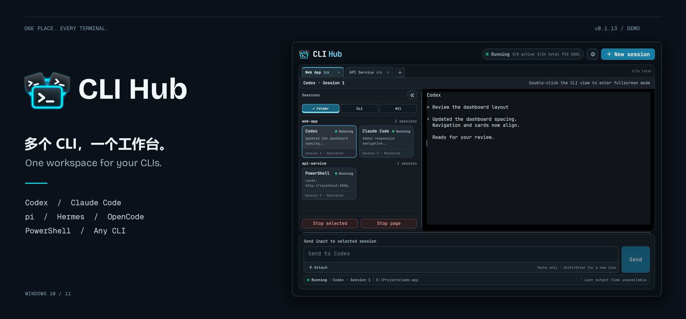

# CLI Hub

**少切窗口，多做事情。｜Fewer windows. More focus.**

[下载 Windows 版本 / Download for Windows](https://github.com/sangowu/cli-hub-releases/releases/latest) · [历史版本 / All releases](https://github.com/sangowu/cli-hub-releases/releases)

## 中文

同时使用多个 Codex、Claude Code 或终端，却被满屏窗口困扰，找不到对应的项目？

CLI Hub 是一款基于 Rust 与 Tauri 构建的 Windows 桌面工作台，让你在一个界面中启动、查看和使用多个命令行工具。

- **按项目管理**：多工作区标签页，支持按工作目录、按 CLI 类型和不分组三种视图。每个工作区最多 8 个活动会话，全局最多同时运行 24 个。
- **高效交互**：实时输出预览、完整交互终端、多行输入，以及 Codex / Claude Code 的统一 Shift+Enter 换行快捷键。
- **后台继续运行**：关闭、重启或更新界面时，已运行的 CLI 可继续在后台工作；重新打开即可连接原有会话。
- **启动更省心**：保存多套启动配置，保留会话卡片，并可选择在后台进程停止后，下次启动时重新启动此前运行的 CLI。
- **兼容多种工具**：内置 Codex、Claude Code、PowerShell 和 CMD 入口，也支持自定义 CLI。提供中英文界面与明暗主题。

### 下载与使用

1. 前往[最新版本](https://github.com/sangowu/cli-hub-releases/releases/latest)，下载 `.exe` 或 `.msi` 安装包。
2. 安装并打开 CLI Hub，创建工作区，点击 **New session / 新建会话**，选择 CLI 和项目目录。
3. 运行多个会话，通过会话卡片查看输出、切换终端。

需要 **Windows 10/11 x64** 和 **Microsoft Edge WebView2 Runtime**。安装版无需 Node.js 或 Rust；要使用的 CLI 工具需自行安装并配置。

重新启动 CLI 不会恢复工具内部的对话状态。电脑重启或后台进程退出会结束原有任务；如需主动停止全部任务，请使用 **Stop all and exit / 停止全部并退出**。

## English

Running several Codex, Claude Code, or terminal sessions and losing track of which window belongs to which project?

CLI Hub is a Windows desktop workspace built with Rust and Tauri. Launch, monitor, and interact with multiple command-line tools from one interface.

- **Organize by project**: workspace tabs with directory grouping, CLI-type grouping, or an ungrouped view. Run up to 8 active sessions per workspace and 24 across the app.
- **Work comfortably**: live output previews, fully interactive terminals, multiline input, and a shared Shift+Enter newline shortcut for Codex and Claude Code.
- **Keep tasks running**: active CLIs can continue in the background when you close, restart, or update the interface. Reopen CLI Hub to reconnect.
- **Start faster**: save multiple launch profiles, retain session cards, and optionally relaunch previously running CLIs on startup after the background host has stopped.
- **Use your tools**: built-in entries for Codex, Claude Code, PowerShell, and CMD, plus custom CLI support. English and Simplified Chinese interfaces, with light and dark themes.

### Get started

1. Open the [latest release](https://github.com/sangowu/cli-hub-releases/releases/latest) and download the `.exe` or `.msi` installer.
2. Install and open CLI Hub, create a workspace, and choose **New session** to select a CLI and project directory.
3. Run your sessions, preview their output, and switch terminals through the session cards.

Requires **Windows 10/11 x64** and **Microsoft Edge WebView2 Runtime**. The installed app does not require Node.js or Rust. Install and configure your CLI tools separately.

Relaunching a CLI does not restore its internal conversation state. A computer restart or background-host exit ends the original tasks. Use **Stop all and exit** when you want to stop every task explicitly.

---

本仓库提供 CLI Hub 安装包、版本说明及更新清单。应用内更新使用 Tauri 更新签名；Windows 安装包尚未使用 Authenticode 签名。

This repository hosts CLI Hub installers, release notes, and update manifests. In-app updates use Tauri updater signatures; Windows installers are not Authenticode-signed.
